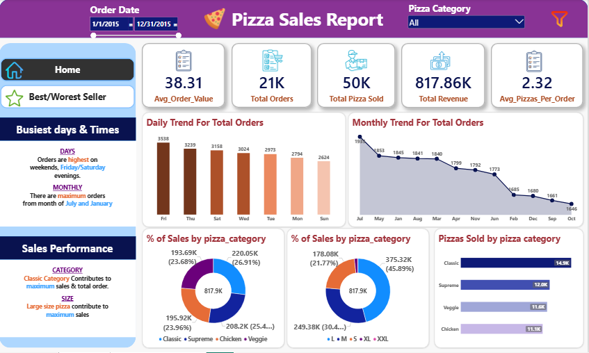

# 🍕 Pizza Sales Performance Dashboard

An end-to-end data analytics project leveraging Microsoft SQL Server (T-SQL) for backend database transformations and views, and Power BI for dynamic, interactive visual dashboards and reporting.

---

## 📌 Table of Contents
- [Project Overview](#-project-overview)
- [Repository Structure](#-repository-structure)
- [Tech Stack & Architecture](#️-tech-stack--architecture)
- [Key Performance Indicators (KPIs)](#-key-performance-indicators-kpis)
- [Dashboard Previews & Insights](#-dashboard-previews--insights)
  - [1. Home Dashboard](#1-home-dashboard-sales--trend-analysis)
  - [2. Best / Worst Sellers Dashboard](#2-best--worst-sellers-dashboard)
- [SQL vs. DAX Architecture Note](#-sql-vs-dax-architecture-note)
- [How to Reproduce](#-how-to-reproduce)

---

## 📊 Project Overview

This project provides comprehensive insights into restaurant sales performance, ordering patterns, revenue contributors, and product popularity. The objective is to enable data-driven business decisions regarding operational staffing, inventory management, and strategic marketing campaigns.

---

## 📁 Repository Structure

```text
📦 Pizza-Sales-Analytics
 ├── Dashboard_Images/
 │   ├── Home1.PNG                    # Screenshot of Home Dashboard
 │   └── Best-Worst Sellers1.PNG      # Screenshot of Best/Worst Sellers Dashboard
 ├── Sql_Queries/
 │   └── queries.sql                  # T-SQL scripts for views, KPIs, and rankings
 ├── Pizza Sales.pbix                 # Interactive Power BI Report File
 └── README.md                        # Documentation
```
---

## 🛠️ Tech Stack & Architecture

- **Database Engine:** Microsoft SQL Server (T-SQL)
- **Visualization Engine:** Power BI Desktop
- **Data Modeling:** Data Analysis Expressions (DAX)

**Hybrid Data Strategy:**
1. **Database Layer (SQL Server):** Pre-aggregated and structured transactional data using custom T-SQL views (`vw_KPI_*`, `vw_Chart_*`, `vw_Top5_*`, `vw_Bottom5_*`) to perform foundational data cleaning, date parsing, and validation.
2. **Semantic & Interactive Layer (Power BI / DAX):** Implemented dynamic DAX measures for core KPIs and chart metrics to ensure complete responsiveness to multi-select page slicers (*Order Date* and *Pizza Category*).

---

## 📈 Key Performance Indicators (KPIs)

- **Total Revenue:** $817.86K — Total value of all pizza transactions.
- **Total Orders:** 21K — Distinct order volume.
- **Total Pizzas Sold:** 50K — Total individual units sold.
- **Average Order Value (AOV):** $38.31 — Average revenue generated per unique order.
- **Average Pizzas per Order:** 2.32 — Average unit quantity per transaction.

---

## 📸 Dashboard Previews & Insights

### 1. Home Dashboard (Sales & Trend Analysis)


**Key Insights:**
- **Busiest Days:** Orders peak during weekend evenings, particularly **Friday and Saturday**.
- **Monthly Distribution:** Highest sales volumes occur in **July** and **January**, with a gradual decline towards the fourth quarter.
- **Category Drivers:** The *Classic* category leads total sales ($220.05K / 26.91%) and quantity (14.9K pizzas sold).
- **Size Drivers:** *Large (L)* size pizzas contribute the highest proportion of total sales ($375.32K / 45.89%).

### 2. Best / Worst Sellers Dashboard


**Key Insights:**
- **Top Revenue Performer:** *The Thai Chicken Pizza* leads total revenue ($43.43K).
- **Top Volume Performer:** *The Classic Deluxe Pizza* leads in total orders (2,329) and total quantity sold (2,453).
- **Lowest Overall Performer:** *The Brie Carre Pizza* ranks consistently lowest across revenue ($11.59K), quantity (490), and orders (480).

---

## 💡 SQL vs. DAX Architecture Note

During development, pre-aggregated database views were initially created in T-SQL. However, static database aggregations restrict dynamic filtering when interacting with visual slicers in Power BI. 

To achieve full interactivity:
- **SQL Server Views** were utilized for backend validation, exploratory data analysis (EDA), and data structure verification.
- **DAX Measures** were written directly within Power BI to perform real-time, dynamic aggregations based on active user filter contexts.

---

## 🚀 How to Reproduce

1. **Database Setup:**
   - Execute the queries inside `Sql_Queries/queries.sql` on your Microsoft SQL Server instance containing the `pizza_sales` table.
2. **Power BI Dashboard:**
   - Open `Pizza Sales.pbix` in Power BI Desktop.
   - Update the SQL Server data source credentials to point to your local or remote database instance.

---

## 👤 Author
- **Shahd Elsayed**
